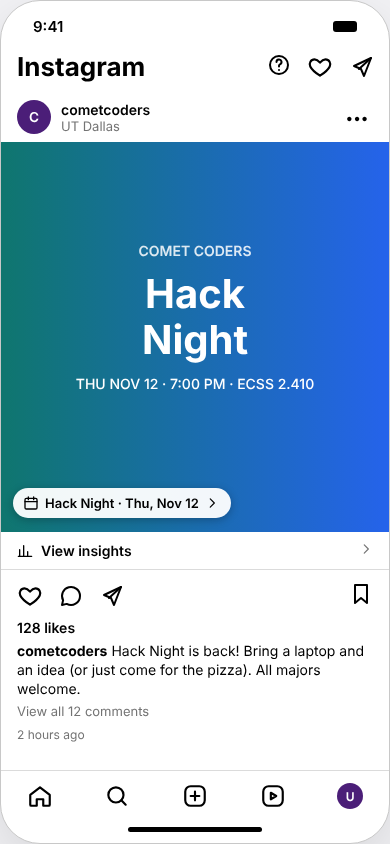
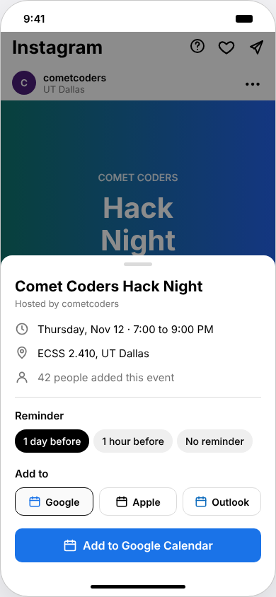
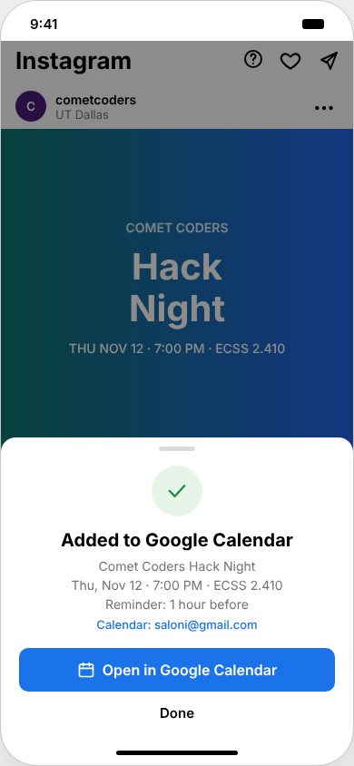
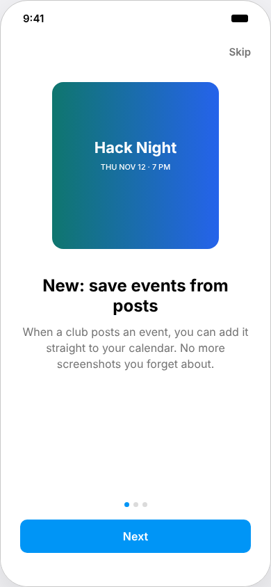
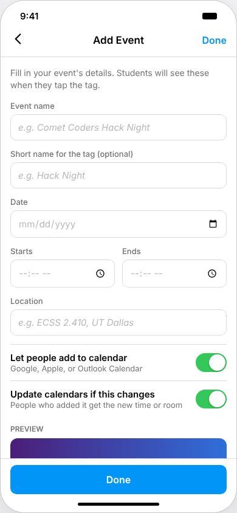
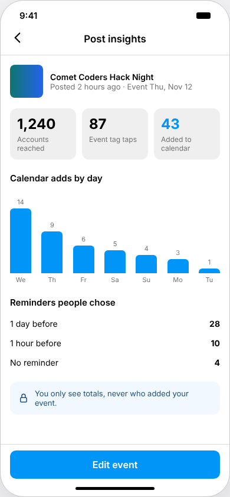

# Instagram Event Tags 📅

**Save a campus event from an Instagram post to your calendar in one tap.**

### 👉 [Try it live: insta-events-ws86.onrender.com](https://insta-events-ws86.onrender.com)

📄 **[Read the full build log (PDF)](docs/build-log.pdf):** every step from idea to launch, and every bug I fixed.

Clubs post their events on Instagram, and students screenshot the flyer and forget about it. This project adds an **Event tag** to posts. Tap it, pick a reminder, and the event goes straight into your Google, Apple, or Outlook Calendar. If the club changes the time or room later, your calendar updates on its own.

A working, deployed prototype with a React frontend, a Node backend, a hosted SQLite database, and the Google Calendar API, built as a product management project (Fall 2026).

> This is a student concept project. It is not made by or affiliated with Instagram or Meta.

<p align="center">
  
  
  
</p>

---

## Features

### For students
- **Event tag on posts.** Tap it to see the date, time, location, and how many people added it.
- **Pick a reminder:** 1 day before, 1 hour before, or none.
- **Google Calendar:** sign in once with Google and the event is added to your real calendar automatically, with your reminder and a color for each club.
- **Apple and Outlook Calendar:** downloads an event file (.ics) that opens in your calendar app, no sign in needed.
- **No duplicates.** Adding the same event twice updates it instead of making a second copy. If you deleted it from your calendar, adding it again makes a fresh one.
- **Bookmark nudge.** Saving a post with an event asks if you want it in your calendar too.
- **First time walkthrough** and a tooltip so people know the tag exists.

### For clubs (creators)
- **Add Event** when making a post: name, date, time, location, plus a live preview.
- **Post insights:** event tag taps, calendar adds, adds by day, and which reminders people picked. Totals only, never who.
- **Edit an event** and it updates in every Google Calendar it was added to.
- **Delete a post** and the event is removed from those calendars too.

<p align="center">
  
  
  
</p>

---

## How it works

```
 Browser (React)            Server (Node + Express)             Google
 ───────────────            ───────────────────────             ──────
 tap "Add to Google"  ──▶   who is this? (session cookie)
                            look up the event in the database
                            sign in as this user with their
                            saved Google keys              ──▶   Calendar API adds
                                                                 the event
 "Added!" + link      ◀──   save the add in the database   ◀──   event id + link
```

- **Sign in:** Google OAuth. The server keeps each person's Google login keys in the database. The browser only gets a random session cookie that the page can't read.
- **Database:** SQLite, hosted on Turso so nothing is lost when the server restarts. Four tables: `users`, `sessions`, `posts`, and `adds` (who added which event, to which calendar, with which reminder).
- **Permissions:** if someone signs in but unchecks calendar access on Google's screen, the app catches it and asks them to try again.
- **Edits:** when a club edits an event, the server finds everyone who added it to Google, signs in as each of them, and updates their event, all at the same time.
- **Insights** are counted live from the `adds` table.

---

## Built with

| Part | Tools |
| --- | --- |
| Frontend | React, Vite, plain CSS |
| Backend | Node.js, Express |
| Database | SQLite, hosted on Turso |
| Hosting | Render (website and server together) |
| APIs | Google OAuth 2.0, Google Calendar API |
| Other | .ics calendar files for Apple and Outlook |

---

## Try it

**[insta-events-ws86.onrender.com](https://insta-events-ws86.onrender.com)**

1. Tap the **Event tag** on the Hack Night post.
2. Pick a reminder and a calendar, then tap **Add**.
3. To make your own event, tap **+** at the bottom, add a photo and caption, then tap **Add Event**.

A few things to know:
- **It may take up to a minute to load** the first time. It runs on a free server that sleeps when no one is using it.
- **Apple and Outlook work for anyone.** They download an event file, no sign in needed.
- **Google Calendar only works for invited testers** while the app is in testing mode. Google will show a "this app hasn't been verified" warning because it's a student project. Click **Continue**. Want to try it? Message me and I'll add your email.

---

## Project structure

```
insta-events/
├── src/                     the React app
│   ├── App.jsx              all the screens and what happens on each tap
│   ├── components/          small pieces: Post, Flyer, EventTag, Sheet...
│   ├── screens/             student screens: Feed, EventCard, AddedSheet...
│   │   └── creator/         club screens: NewPost, EventForm, Insights
│   └── utils/               api.js (talks to the server), .ics files, dates
├── server/
│   ├── index.js             all the routes (sign in, posts, calendar), also serves the website online
│   ├── db.js                the database tables (local file or Turso)
│   └── seed.js              the starting demo post
└── docs/screenshots/
```

---

## How it was built

This started as a product management project, so the app changed based on real feedback.

1. **Problem:** students miss club events because a flyer post is easy to forget.
2. **Research:** user interviews and empathy maps, then requirements and user flows.
3. **V1:** first version built and tested with 3 users in recorded feedback sessions.
4. **What users said and what changed in V2:**
   - *"I use Apple Calendar."* Added Apple and Outlook.
   - *"I didn't know I could tap the tag."* Added a walkthrough, a tooltip, and a pulse on the tag.
   - *"I saved the post first."* The bookmark now offers to add the event.
   - *"Every club looks the same in my calendar."* Each club now gets its own color.
5. **Backend:** a real server, Google sign in, adding events with the Calendar API, then a database with a login for each person.

| Version | What's in it |
| --- | --- |
| Day 1 | Express server connected to the React app |
| Day 2 | Sign in with Google |
| Day 3 | Events added straight to Google Calendar with reminders and colors |
| Day 4 | SQLite database, a login per person, edits and deletes reach everyone's calendar |
| Launch | Deployed on Render with the database on Turso |
| Real users | Friends signed in, added events, and made posts. Two bugs found and fixed the same day |

---

## Bugs I fixed

A few of the most interesting ones. The [build log](docs/build-log.pdf) has all of them.

| What went wrong | Why | Fix |
| --- | --- | --- |
| App said "Added," but the event wasn't in my calendar ("Could not find the requested event") | Google keeps deleted events as hidden "cancelled" copies, and my app was updating the hidden copy | Check if the event was cancelled first, and add a fresh one if so |
| A friend's add failed with "insufficient authentication scopes" | She unchecked the calendar permission box when signing in | Check permissions at sign in and ask again with a note to check the box |
| Google sign in failed with `redirect_uri_mismatch` after launch | The live server was still sending Google an old address | Read Google's error details, fixed the setting on Render, redeployed |
| Sign in got stuck after clicking Continue | A missing setting sent people back to `localhost` | Added `FRONTEND_URL` and checked the server log before testing |
| Database would be wiped on the free server | Render's free plan erases files on every restart | Moved the database to Turso (hosted SQLite) |
| Posts disappeared on refresh, and only one person could sign in | Everything lived in browser memory and one shared login file | Day 4: a real database and a session cookie per person |

---

## What's next

- [x] Put it online so it runs without my laptop
- [x] Real people using it (friends added events and made their own posts)
- [ ] Creator accounts: posts belong to whoever made them, and only they can edit or delete them
- [ ] Notify people when an event they added changes
- [ ] AI reads the flyer and fills in the event details

---

Made by **Saloni Roy**, UT Dallas, Computer Science + Economics
